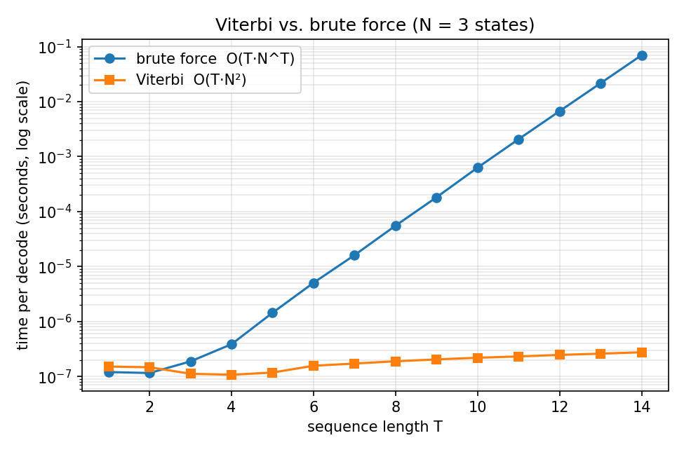
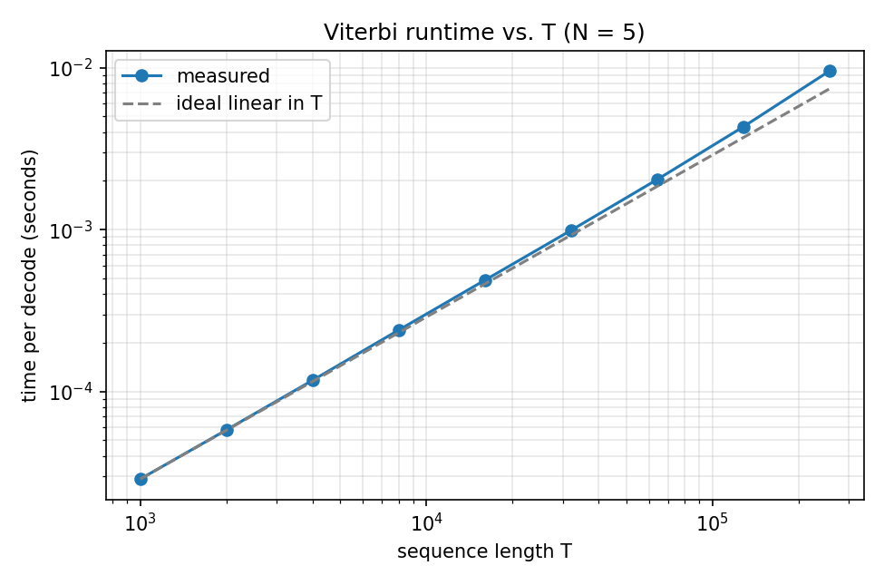
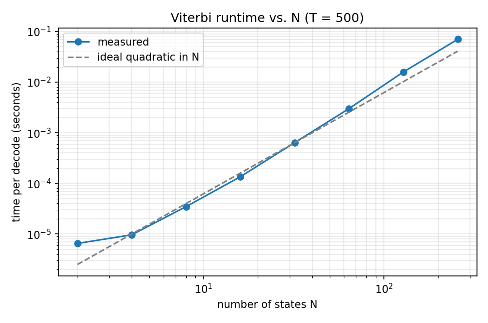

# Viterbi decoding for Hidden Markov Models (C++)

For this project I created a Viterbi decoder, and applied it to part-of-speech
(POS) tagging. I then verified it against a brute-force oracle.

```
src/viterbi.hpp       log-space Viterbi + HMM struct          
src/brute_force.hpp   exhaustive decoder used as an oracle
src/models.hpp        weather and dishonest-casino HMMs
src/test_viterbi.cpp  unit tests
src/benchmark.cpp     runtime experiments -> results/*.csv
src/pos_tagger.cpp    bigram-HMM POS tagger + most-common-tag baseline
scripts/              Brown export, sample-corpus generator, plotting
```

Build and run (needs g++ with C++17; Python + matplotlib only for plots):

```
make test          # unit tests
make bench         # benchmarks + PNG plots in results/
make pos-sample    # POS pipeline on a small synthetic corpus (smoke test)
pip install nltk && python3 scripts/export_brown.py && make pos   # real Brown run
```

## 1. HMMs in one page

A HMM (Hidden Markov Model) models a situation where we can see some information 
but not other information. For instance, a patient may say they are "normal"
"cold" or "dizzy" but whether or not they have a feaver is unkown. We can define
these hidden states as `q_1..q_T` and the observed states as  `o_1..o_T`.

This model is defined by three things:

* `pi[i]` = P(q_1 = i) : ex(pi = healthy .6, fever .4)
* `A[i][j]` = P(q_{t+1} = j | q_t = i) : probability of moving from state i to state j
* `B[i][k]` = P(o_t = k | q_t = i) : probability that state i produces observation k

In order to simplify the model into something that can be realistically computed,
we assume the following: the **Markov assumption** (the next state
depends only on the current state) and **output independence** (an observation
depends only on the state that emitted it). Together they give the joint
probability of a path and the observations:

```
P(q, o) = pi[q_1] B[q_1][o_1]  *  prod_{t=2..T} A[q_{t-1}][q_t] B[q_t][o_t]
```

**Decoding** asks: which state sequence `q` maximises `P(q, o)`? There are `N^T`
candidates, so brute force is hopeless beyond tiny inputs.

## 2. The Viterbi algorithm

The goal of the Viterbi algorithm is to find the most likely sequence of 
hidden states that explains a given sequence of observed events.

Key observation: the best path ending in state `j` at time `t` must extend the
best path ending in *some* state `i` at time `t-1`. So we only need to remember,
per time step and per state, the best score and where it came from.

```
delta_1(j) = log pi[j] + log B[j][o_1]
delta_t(j) = max_i [ delta_{t-1}(i) + log A[i][j] ] + log B[j][o_t]
psi_t(j)   = argmax_i [ delta_{t-1}(i) + log A[i][j] ]          (back-pointer)
```

Finally pick the best final state, follow the stored pointers back to rebuild the path, 
and note that filling TxN cells with N comparisons each costs O(T*N^2) time, while only the 
TxN back-pointers need to be stored in full.

**Why log space?** A path probability is a product of `2T` numbers below 1. In
`double` precision it underflows to exactly 0 after a few hundred steps; the
casino test shows `log P = -180606` for T = 100,000, whose exponential is 0.
Adding logs avoids this and turns the products into sums. `log(0) = -inf`
represents impossible events, which then can never win a `max`; `-inf` plus a
finite number stays `-inf`, so no NaNs appear.

### Worked example (Healthy/Fever)

`pi = (H .6, F .4)`, `A = [[.7,.3],[.4,.6]]`,
`B(H) = (normal .5, cold .4, dizzy .1)`, `B(F) = (.1, .3, .6)`.
Observations: **normal, cold, dizzy** (probabilities shown instead of logs for readability).

| t | obs | delta(H) | delta(F) |
|---|-----|----------|----------|
| 1 | normal | .6 x .5 = **.30** | .4 x .1 = **.04** |
| 2 | cold | max(.30 x .7, .04 x .4) x .4 = .21 x .4 = **.084** (from H) | max(.30 x .3, .04 x .6) x .3 = .09 x .3 = **.027** (from H) |
| 3 | dizzy | max(.084 x .7, .027 x .4) x .1 = **.00588** (from H) | max(.084 x .3, .027 x .6) x .6 = .0252 x .6 = **.01512** (from H) |

The best final state is Fever (.01512); backtracking through the pointers gives
**Healthy, Healthy, Fever**. The unit test checks exactly this path and probability.

## 3. Testing

`make test` runs 1,107 checks:

* weather textbook example (path and probability .01512);
* **all** 1,092 weather observation sequences of length 1..6 against brute force;
* a 20-roll dishonest-casino sequence against brute force. The decoded states
  are `FFFFFFFFFFLLLLLLFFFF`: the loaded die appears exactly over the run of six 6s;
* 500 random HMMs (2-5 states, 2-6 symbols, T up to 8) against brute force;
* edge cases: T = 0, T = 1, zero-probability transitions, impossible observations (-inf, no NaN);
* underflow: T = 100,000 casino simulation, finite log-probability, and
  Viterbi recovers the true state 79% of the time vs. 66.5% for "always say Fair".

**Ties.** The random test compares scores, not just paths. Two different paths
can have exactly equal probability (same transitions/emissions in another order);
my first version compared paths and failed 3/500 trials for this reason. The test
now requires (1) the optimal log-probability to match brute force and (2) the
returned path to really achieve it, recomputed independently.

## 4. Benchmarks

`make bench` writes `results/bench_*.csv` and the three plots below.



Figure 1: N = 3 states. Brute force grows by about 3x per extra time step (`3^T`), Viterbi
barely moves: at T = 14 brute force needs ~51 ms vs ~0.24 us for Viterbi
(~200,000x). At low values T (less than 2) brute force is actually equal or faster, since
vertibi reserves time to allocate for tables. The crossover is at T ~ 2.2.



Figure 2: Viterbi at number of tags (N) N = 5: time grows linearly with time steps (T)
(~25-35 ns per time step). It drifts up slightly at large T as the 
back-pointer table stops fitting in cache.



Figure 3. Viterbi runtime grows quadratically with the number of states N (T = 500), 
matching the O(T*N^2) prediction. The dashed line shows ideal quadratic growth.

## 5. POS tagging

Now we apply this to tagging english words. Here we apply this algorithm to the Brown Corpus.

**Model.** A bigram HMM: hidden states are tags (noun,verb,etc.), observations are words.
`pi[t]` comes from how often a sentence starts with tag `t` divided by number of sentences.
`A[s][t]` comes from how often tag `t` is followed by tag `s`divided by how often `s` appears 
with a successor. Emmisions: `B(word|tag)` come frome the number of times a word appears with
tag `t` divided by how many times tag `t` has appeared. 

**K-smoothing.** Some tag pairs never actually occur which would mean A = 0, and rule out any path 
from using them. So, I added k=0.001 to every pair to keep those probabilities non-zero. 

**Why T x N matrix instead of a discrete B table**. In the examples, there are only a few possible 
observations, so B is a small table. For words, there are tens of thousands of possible observations, 
and unknown words too. So the tagger computes, for each word in the sentence, a row of N numbers log B(word | tag) and stacks them into a T x N matrix. viterbi_decode accepts that matrix directly, so the same decoder code works for both weather and POS tagging.

**Unknown words.** Words never seen in training would have a count of zero. Every emission would then be log(0) which would be undefined. To fix this we describe the unknown word by its characteristics
(capitalised, all-caps, contains digit, hyphen, suffix `-ing`/`-ed`/`-ly`/`-tion`/...).
Emissions for each characteristic are estimated from words that occur only **once** in
training. I chose thise since words only seen once are good stand-ins for words never seen before. 
For instance to get the emissions for -ing we look at all words that appear only once ending with -ing. 
We find that most rare words that end with -ing are verbs so an unkown word ending with -ing is most likely a verb.

**Baseline.** Tag every word with its most frequent training tag. unknown words
get the globally most frequent tag.

**Evaluation.** Every 10th sentence is held out (90/10 split). Accuracy is
reported overall and separately for known vs. unknown words.

### Results

| Corpus | Baseline | HMM + Viterbi |
|--------|----------|---------------|
| Brown, universal tagset (12 tags) | 94.56% | 96.97% |
| Brown, full tagset (~459 tags) | 89.19% | 94.49% |

As we can see the Viterbi algorithm had a noticeably higher accuracy
in tagging words than the baseline model, being just over 2.4% more accurate on the universal
corpus and 5.3% more accurate on the full corpus.


## 6. Limitations

* **Bigram assumption.** Tags depend only on the previous tag, so longer-range
  structure is invisible. Trigram tag models usually help; they square the state
  space (`N^2` states, `O(T N^3)` time).
* **Emission model.** A word depends only on its own tag, so features such as
  suffix, capitalisation, and neighbouring words enter only through the crude
  signature trick. Discriminative models (MEMMs, CRFs, neural taggers) use such
  features directly and beat HMMs on this task.
* **Unknown words** remain the main weakness; the hand-built signature classes
  are a heuristic.
* **Smoothing** (add-k with a fixed k) is untuned. Held-out tuning or
  interpolation would help.
* **Viterbi gives the single best sequence**, not the most probable tag per word;
  posterior (forward-backward) decoding can differ and sometimes scores higher
  per-token accuracy. It also returns no confidence.
* **Cost** is `O(T N^2)`: fine for 12 tags, but for ~470 tags or large state
  spaces you would use beam search or sparse transitions.
* **Parameters are estimated by counting** from labelled data (supervised). I did
  not implement Baum-Welch for unlabelled data.
* **Benchmark caveats:** single machine, random HMMs, no pinning of CPU frequency;
  brute force is limited to T = 14 by design.

## How to run

### Requirements

- Linux, macOS, or WSL with `g++` supporting C++17 (GCC 7+ or Clang 5+) and `make`
- Python 3 with `matplotlib`, only for the benchmark plots
- Python 3 with `nltk`, only for downloading the Brown corpus (needs internet)

```
pip install matplotlib nltk
```

All commands below run from the project root (the folder containing `Makefile`).

### 1. Build

```
make
```

This compiles three programs: `test_viterbi`, `benchmark`, and `pos_tagger`.
Use `make clean` to delete them.

### 2. Run the tests

```
make test
```

Expected: all checks pass and the last line reads `1107 checks, 0 failed`.
The exit status is nonzero if any check fails.

### 3. Run the benchmarks

```
make bench
```

This writes three CSV files and three PNG plots to `results/`:
`bench_vs_brute`, `bench_scale_T`, `bench_scale_N`. It takes under a minute.
Timings depend on your machine, so quote your own numbers.

### 4. Try the POS tagger on the synthetic sample (no download)

```
make pos-sample
```

This generates `data/sample_tagged.txt` and tags it. It is a smoke test only;
the corpus is synthetic, not real English.

### 5. Run the POS tagger on the Brown corpus

Export the corpus once:

```
python3 scripts/export_brown.py          # 12-tag universal tagset -> data/brown_tagged.txt
python3 scripts/export_brown.py --full   # original Brown tags     -> data/brown_full_tagged.txt
```

Then run the tagger:

```
make pos                                  # universal tagset (fast, about a second)
./pos_tagger data/brown_full_tagged.txt   # full tagset (slow; see below)
```

Expected for the universal tagset: 57,340 sentences, 12 tags, and a table
comparing the baseline with HMM + Viterbi, followed by the most frequent errors
and an example sentence.

The full-tagset run has 459 tags in the training split. Viterbi costs O(T·N²),
so it takes minutes rather than seconds. This is expected.

### 6. Tag your own sentence

```
./pos_tagger data/brown_tagged.txt --sentence "the old dog will watch a quiet river ."
```

Put spaces around punctuation, since the tagger splits on whitespace.


